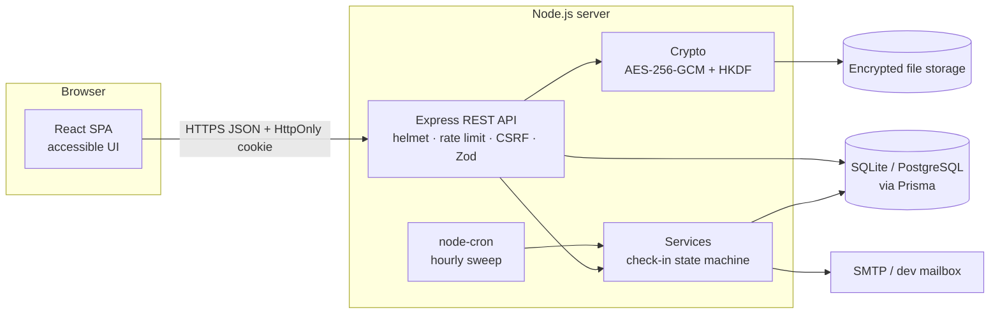
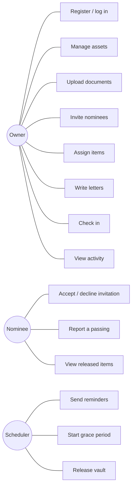
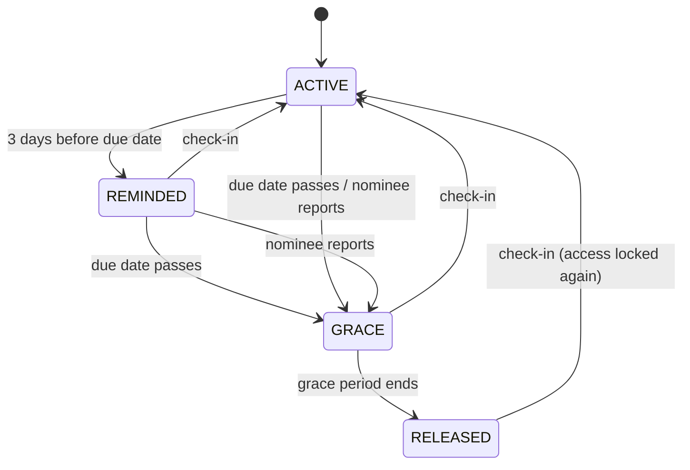
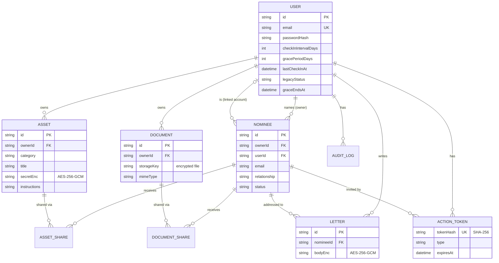
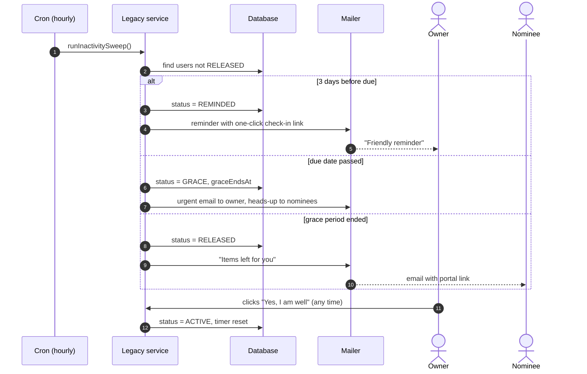
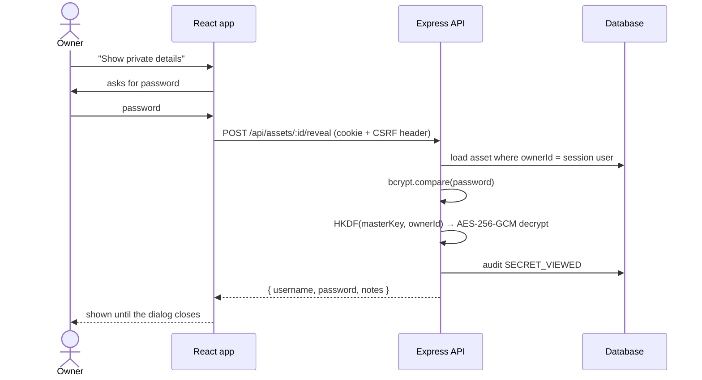
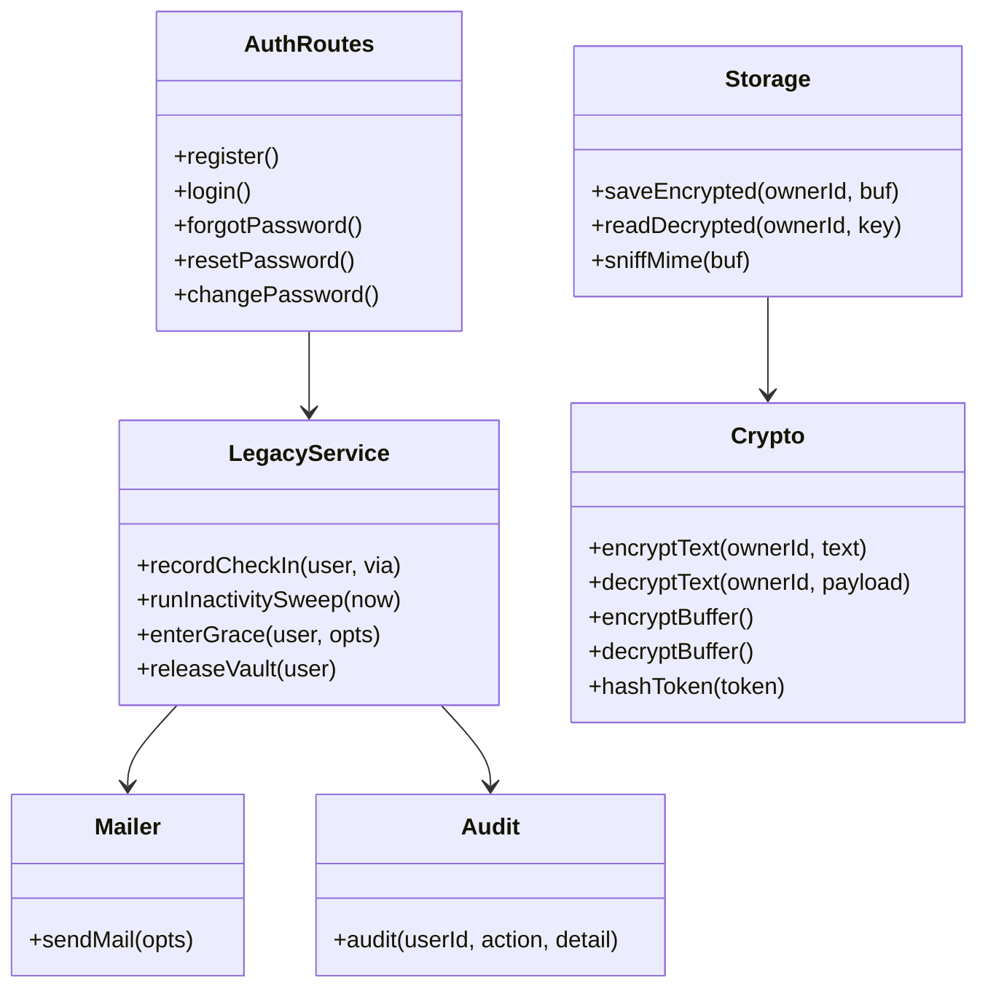

# Architecture & UML

All diagrams are written in Mermaid, which GitHub renders automatically.

## System architecture

## Use-case diagram

## Legacy status: state diagram

## ER diagram

## Sequence: inactivity and release

## Sequence: viewing an encrypted secret

## Class diagram (server modules)

